<style>
body { line-height: 1.65; }
h1, h2 { color: #24435B; }
.table-responsive { overflow-x: auto; }
table { font-size: 0.90em; }
.caption { color: #5E6A71; font-style: italic; }
.scroll-output { max-height: 520px; overflow-y: auto; }
</style>

```{r setup, include=FALSE}
knitr::opts_chunk$set(
  echo = FALSE,
  warning = FALSE,
  message = FALSE,
  fig.align = "center",
  out.width = "92%"
)

suppressPackageStartupMessages({
  library(tidyverse)
  library(knitr)
})

options(scipen = 999)
set.seed(131)

raw_data <- readr::read_csv("data/raw/sustainable_energy_dataset.csv", show_col_types = FALSE)
selected_missing_data <- raw_data |>
  janitor::clean_names() |>
  select(
    entity,
    year,
    access_to_electricity_percent_of_population,
    access_to_clean_fuels_for_cooking,
    renewable_electricity_generating_capacity_per_capita,
    gdp_per_capita,
    land_area_km2,
    electricity_from_fossil_fuels_t_wh,
    electricity_from_nuclear_t_wh,
    electricity_from_renewables_t_wh,
    low_carbon_electricity_percent_electricity,
    primary_energy_consumption_per_capita_k_wh_person,
    value_co2_emissions_kt_by_country
  )
prepared_data <- readr::read_csv("data/processed/sustainability_clean.csv", show_col_types = FALSE)
codebook <- readr::read_csv("data/codebook.csv", show_col_types = FALSE)
missing_summary <- readr::read_csv("data/results/missing_summary.csv", show_col_types = FALSE)
preparation_summary <- readr::read_csv("data/results/preparation_summary.csv", show_col_types = FALSE)
split_summary <- readr::read_csv("data/results/split_summary.csv", show_col_types = FALSE)
recipe_summary <- readr::read_csv("data/results/recipe_tuning_summary.csv", show_col_types = FALSE)
cv_comparison <- readr::read_csv("data/results/cv_model_comparison.csv", show_col_types = FALSE)
selected_models <- readr::read_csv("data/results/selected_models.csv", show_col_types = FALSE)
test_metrics <- readr::read_csv("data/results/final_test_metrics.csv", show_col_types = FALSE)
importance_data <- readr::read_csv("data/results/random_forest_variable_importance.csv", show_col_types = FALSE)
```

# Introduction

Climate change is changing the environment quickly. It affects ecosystems, economies, and daily life. Many countries and organizations are trying to reduce greenhouse gas emissions. CO2 is one of the main gases that causes climate change. A large amount of CO2 comes from energy production and energy use. People are looking for ways to reduce fossil-fuel use and use more clean energy. I think a prediction model can give us a useful starting point. It can show which factors are closely related to high CO2 emissions.

## What Are We Going to Explore?

This project predicts the annual CO2 emissions of a country. The outcome is measured in kilotonnes (kt). It is total emissions instead of emissions per person. My research question is: **How accurately can country-level CO2 emissions be predicted from economic, social, energy, geographic, and time-related characteristics?** I use predictors such as electricity access, GDP per capita, land area, and electricity generation. Country and year are also included.

Five regression models are compared. They are linear regression, elastic net, K-nearest neighbors (KNN), random forest, and gradient-boosted trees. CO2 emissions are very different across countries. A base-10 log transformation is used for the outcome. The models use the same ten cross-validation folds. Only the best one or two models are tested on the later years.

## Why Do We Want to Predict This?

Sustainability is connected to my own experience. I worked on a related sustainability project before. I also work in sustainability at UC Santa Barbara now. This project lets me study whether these factors can work together to predict CO2 emissions. A good model may show which measurements need more attention. It may also give me ideas for future research on emission reduction.

Another goal is to find which factors are most useful to the models. I know that predictive importance is not a causal effect. A variable may represent country size, development, or infrastructure. This report only describes predictive patterns. It does not claim that changing one factor will directly change CO2 emissions.

# Data Description

## Data Source and Structure

The data come from the [Global Data on Sustainable Energy (2000–2020)](https://www.kaggle.com/datasets/anshtanwar/global-data-on-sustainable-energy/data) dataset on Kaggle. I load the raw file with the following code.

```{r load-and-glimpse, echo=TRUE}
energy_raw <- readr::read_csv(
  "data/raw/sustainable_energy_dataset.csv",
  show_col_types = FALSE
)
dplyr::glimpse(energy_raw)
```

Each row is one country or region in one year. The raw data cover 176 entities from 2000 to 2020. Some values are missing.

## Variable Selection

The original dataset has `r dim(raw_data)[1]` observations and `r dim(raw_data)[2]` variables. I use `dim()` to check this size.

```{r dimensions, echo=TRUE}
dim(energy_raw)
```

The codebook below lists all original columns. The *Role* column shows the outcome, selected predictors, and excluded variables.

```{r codebook-table, results='asis'}
codebook |>
  select(
    `Original variable` = original_variable,
    `Analysis name` = clean_variable,
    Type = type,
    Role = role,
    Description = description
  ) |>
  kable(
    format = "html",
    caption = "Complete codebook for the 21 variables in the raw dataset",
    escape = TRUE,
    table.attr = "class='table table-striped table-hover table-condensed'"
  )
```

The outcome is `Value_co2_emissions_kt_by_country`. I rename it `co2_emissions_kt`. It records total national CO2 emissions in kilotonnes. `Entity` and `Year` are also kept as predictors. The economic and social group includes electricity access, clean-cooking access, renewable capacity per capita, GDP per capita, and land area. The energy group includes three sources of electricity generation. It also includes the low-carbon electricity percentage and primary energy use per person. These groups only organize the EDA. Every model uses all selected predictors together.

# Data Preparation

## Data Cleaning

The variable names are standardized with `janitor::clean_names()`. I change year to an integer and country to a categorical variable. Land area and population density are parsed as numeric values. Population density is in the codebook, but it is not used in the models. The data have no exact duplicate rows. They also have no duplicate country-year pairs or nonpositive outcome values.

## Missing Data

Figure 1 shows the missing data from `naniar::vis_miss()`. I use it to check the amount and pattern of missing values. Renewable capacity per capita has the most missing values. It has `r missing_summary |> filter(variable == "renewable_capacity_per_capita") |> pull(missing)` missing rows, or `r scales::percent((missing_summary |> filter(variable == "renewable_capacity_per_capita") |> pull(percent))/100, accuracy = 0.1)`. The outcome has `r missing_summary |> filter(variable == "co2_emissions_kt") |> pull(missing)` missing rows, or `r scales::percent((missing_summary |> filter(variable == "co2_emissions_kt") |> pull(percent))/100, accuracy = 0.1)`. GDP per capita has `r missing_summary |> filter(variable == "gdp_per_capita") |> pull(missing)` missing rows, or `r scales::percent((missing_summary |> filter(variable == "gdp_per_capita") |> pull(percent))/100, accuracy = 0.1)`. All 175 outcome values in 2020 are missing. Each earlier year has 12 to 16 missing outcome values.

```{r missing-data-code, echo=TRUE, fig.show='hide'}
naniar::vis_miss(
  selected_missing_data,
  sort_miss = TRUE,
  show_perc_col = TRUE,
  warn_large_data = FALSE
)
```

```{r missing-figure, fig.cap="Figure 1. Missingness pattern among the selected outcome and predictor variables."}
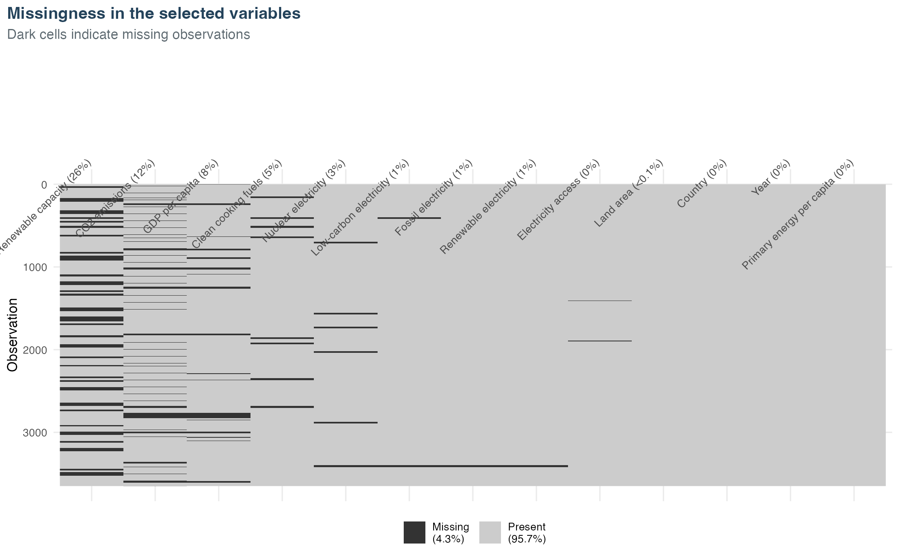
```

For those missing value, I choose to remove them. The recipes do not impute missing predictors. Rows with any missing selected predictor are also removed. The missing value are not caused by data collection or cleaning, so I will treat them similarly as completely random missing values. This leaves `r nrow(prepared_data)` of the original `r nrow(raw_data)` rows. This choice may affect the model results, so I will discussed in the limitations.

## Prepared Dataset

The prepared dataset has `r nrow(prepared_data)` observations from `r n_distinct(prepared_data$entity)` countries. It covers `r min(prepared_data$year)` to `r max(prepared_data$year)`. It contains 12 predictors, the original CO2 outcome, and its base-10 log value. I save the cleaned data as `data/processed/sustainability_clean.csv`. The preparation code is in `code/01_data_preparation.R`.

The table below shows the first six rows of the prepared dataset.

```{r prepared-data-head, echo=TRUE}
head(prepared_data)
```

```{r preparation-table}
preparation_summary |>
  rename(Stage = stage, Observations = observations) |>
  kable(caption = "Observations retained through data preparation")
```

# Exploratory Data Analysis

## Distribution of Carbon Dioxide Emissions

Figure 2 compares the outcome on the original scale and the log scale. Accoridng to the graphs, we can see that the original CO2 values are strongly right-skewed. Hence, I did simple data calculations, and find out the median is about 5,550 kt. The mean is 121,445 kt, and the maximum is 10,707,220 kt. The mean is almost 22 times the median, becaused of outliers. The unit of country-based is very large, so a few large emitters can dominate squared error on the original scale. Therefore, I try log distribution, and it is more balanced. I will use `log10(co2_emissions_kt)` as the modeling outcome and for the cross-validation strata.

```{r outcome-distribution-code, echo=TRUE, eval=FALSE}
outcome_original <- ggplot(eda_data, aes(x = co2_emissions_kt)) +
  geom_histogram(bins = 45, fill = report_colors[["blue"]], color = "white") +
  scale_x_continuous(labels = scales::label_number(scale_cut = scales::cut_short_scale())) +
  labs(
    title = "Original scale",
    x = "CO2 emissions (kilotonnes)",
    y = "Country-year observations"
  )

outcome_log <- ggplot(eda_data, aes(x = log10_co2_emissions)) +
  geom_histogram(bins = 35, fill = report_colors[["coral"]], color = "white") +
  labs(
    title = "Logarithmic scale",
    x = "log10(CO2 emissions in kilotonnes)",
    y = "Country-year observations"
  )

outcome_distribution_plot <- outcome_original + outcome_log +
  plot_annotation(
    title = "Distribution of country-level CO2 emissions",
    subtitle = "A logarithmic transformation reduces the influence of extreme emitters"
  )
```

```{r outcome-distribution, fig.cap="Figure 2. Distribution of country-level CO2 emissions before and after a base-10 logarithmic transformation."}
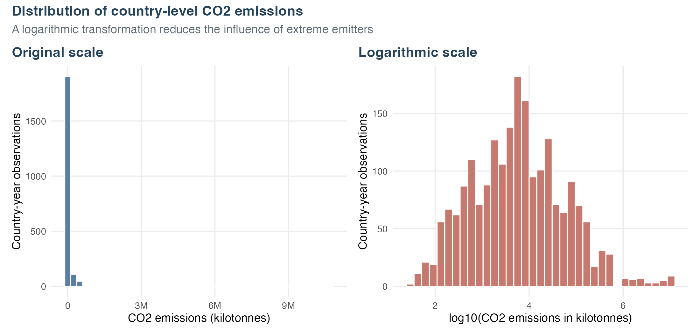
```

## Carbon Dioxide Emissions Over Time

Figure 3 shows the yearly median of CO2 emissions. The median is 4,030 kt in 2000. It increases to 7,690 kt in 2019. The line does not increase every year. I keep the later years for testing to represent a later time period.

```{r time-trend-code, echo=TRUE, eval=FALSE}
time_plot <- ggplot(annual_summary, aes(x = year, y = median_co2)) +
  geom_line(color = report_colors[["navy"]], linewidth = 1) +
  geom_point(color = report_colors[["navy"]], size = 2) +
  scale_y_log10(labels = scales::label_number(scale_cut = scales::cut_short_scale())) +
  scale_x_continuous(
    breaks = seq(min(annual_summary$year), max(annual_summary$year), by = 2)
  ) +
  labs(
    title = "Median country-level CO2 emissions increased over time",
    subtitle = "Each point shows the median across countries in that year",
    x = "Year",
    y = "CO2 emissions (kilotonnes, log scale)"
  )
```

```{r time-trend, fig.cap="Figure 3. Annual median of country-level CO2 emissions."}
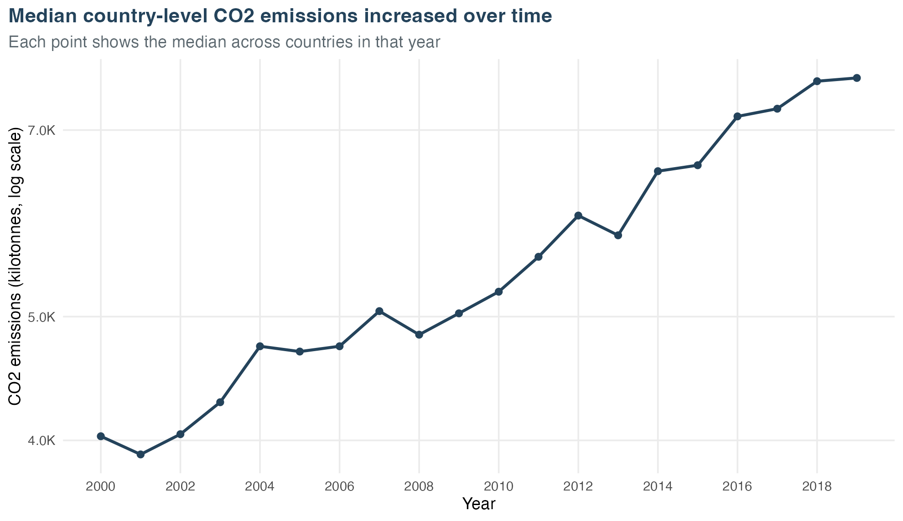
```

## Relationships Between Emissions and Selected Predictors

The three numeric predictors with the largest absolute Spearman correlations are fossil electricity, renewable electricity, and land area. I select them for Figure 4. Fossil electricity has the strongest relationship with log10 emissions ($\rho = 0.906$). Renewable electricity has a correlation of $\rho = 0.549$. Land area has a correlation of $\rho = 0.511$. Some patterns are curved or clustered. A straight line may not fit every pattern. These plots show associations instead of causal effects.

```{r relationship-figure-code, echo=TRUE, eval=FALSE}
relationship_plot <- ggplot(
  relationship_data,
  aes(x = value, y = log10_co2_emissions)
) +
  geom_point(alpha = 0.22, size = 1.1, color = report_colors[["blue"]]) +
  geom_smooth(
    method = "loess",
    se = FALSE,
    color = report_colors[["coral"]],
    linewidth = 0.9
  ) +
  facet_wrap(vars(predictor), scales = "free_x", ncol = 3) +
  labs(
    title = "CO2 emissions and the strongest numeric predictors",
    subtitle = "Predictors are selected by absolute Spearman correlation with log10 emissions",
    x = NULL,
    y = "log10(CO2 emissions in kilotonnes)"
  )
```

```{r relationship-figure, fig.cap="Figure 4. Log10 CO2 emissions versus the three numeric predictors with the largest absolute Spearman correlations."}
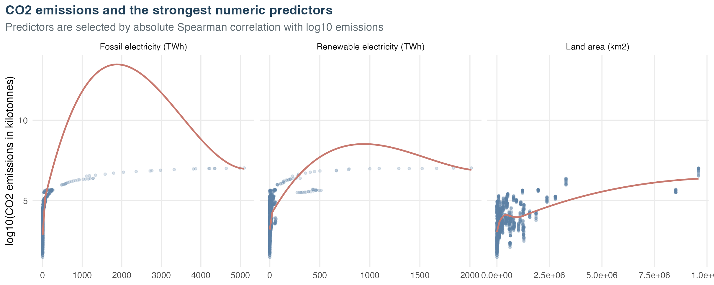
```

## Distributions of Selected Predictors

Figure 5 shows GDP per capita, renewable capacity per capita, and primary energy use per capita. All three distributions are uneven. I use `log10(x + 1)` to make small and large values easier to see. This transformation also keeps zero values. The predictors are scaled inside the resampling process for elastic net and KNN.

```{r predictor-distributions-code, echo=TRUE, eval=FALSE}
predictor_distribution_plot <- ggplot(
  distribution_data,
  aes(x = transformed_value)
) +
  geom_histogram(bins = 35, fill = report_colors[["sand"]], color = "white") +
  facet_wrap(vars(predictor), scales = "free", ncol = 3) +
  labs(
    title = "Selected predictors have uneven distributions",
    subtitle = "Each horizontal axis shows log10(x + 1)",
    x = NULL,
    y = "Country-year observations"
  )
```

```{r predictor-distributions, fig.cap="Figure 5. Distributions of three selected predictors after log10(x + 1) is used for display."}
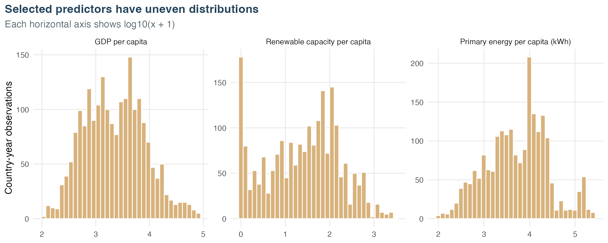
```

## Correlation Between Numeric Variables

Figure 6 shows a Spearman correlation plot. Larger circles mean stronger correlations. Blue circles are positive, and red circles are negative. Each numer in the circle represents the correlation value. From the plot, there are several predictors have similar correlations. Electricity access, clean-cooking access, GDP per capita, and primary energy use are positively correlated. Renewable capacity is related to renewable electricity and the low-carbon share. Fossil electricity has the strongest numeric correlation with the outcome. Correlated predictors may make linear regression coefficients unstable, so I include elastic net and tree models for comparison.

```{r correlation-plot-code, echo=TRUE, eval=FALSE}
correlation_plot <- ggplot(
  correlation_long,
  aes(x = variable_2, y = variable_1)
) +
  geom_tile(fill = "white", color = "#D2D2D2", linewidth = 0.45) +
  geom_point(
    aes(size = abs(correlation), fill = correlation),
    shape = 21,
    color = "#6F6F6F",
    stroke = 0.25
  ) +
  geom_text(aes(label = correlation_label), color = "black", size = 2.8) +
  scale_size_area(max_size = 14, limits = c(0, 1), guide = "none") +
  scale_fill_gradient2(
    low = "#C96A5A",
    mid = "white",
    high = "#2B6087",
    midpoint = 0,
    limits = c(-1, 1),
    name = "Spearman\ncorrelation"
  ) +
  scale_x_discrete(labels = short_labels, position = "bottom") +
  scale_y_discrete(labels = short_labels) +
  coord_equal(clip = "off") +
  labs(
    title = "Correlation among numeric modeling variables",
    subtitle = "Circle size and color show the strength and direction of each correlation",
    x = NULL,
    y = NULL
  ) +
  theme_report(10) +
  theme(
    axis.text.x = element_text(angle = 45, hjust = 1, vjust = 1),
    panel.grid = element_blank(),
    panel.background = element_rect(fill = "white", color = NA),
    legend.position = "right"
  )
```

```{r correlation-heatmap, fig.cap="Figure 6. Spearman correlations among numeric modeling variables."}
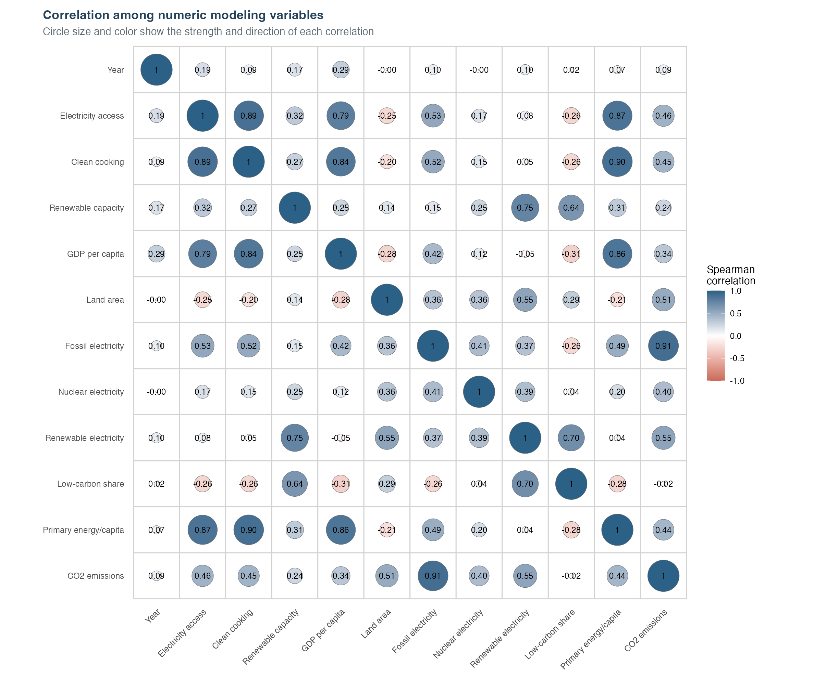
```

# Model Setup

## Data Split

Due to the specialty of this dataset, the observation units are sorted in time order. There are 20 usable years. As the model is aiming to predict the outcome in later years, I use ealier data, 2000–2015, for training. This set has `r split_summary |> filter(set == "Training") |> pull(observations)` observations, or `r round(split_summary |> filter(set == "Training") |> pull(percent), 1)`% of the data. The years 2016–2019 are used for testing. This set has `r split_summary |> filter(set == "Testing") |> pull(observations)` observations, or `r round(split_summary |> filter(set == "Testing") |> pull(percent), 1)`%. This is not a random split. The goal is to test the models on later years. The training median is about 5,150 kt. The testing median is about 7,395 kt. On the other hand, as the CO2 emissions are increasing over time, the later years have higher median values, so it might lead increase the testing error. 

```{r data-split-table}
split_summary |>
  transmute(
    Set = set,
    Year = paste0(first_year, "-", last_year),
    Count = scales::comma(observations),
    Percentage = scales::percent(percent / 100, accuracy = 0.1)
  ) |>
  kable(
    caption = "Training and testing data split",
    align = c("l", "c", "r", "r")
  )
```

## Ten-Fold Cross-Validation

I set k = 10, which divides training set into ten folds. Because the log10 outcome of CO2 are continuous variables without obvious categories, so I split them into five strata. This helps each fold cover the outcome distribution. Each model is fit on nine folds and validated on the remaining one fold. The process is repeated ten times and each fold is used once for validation. All five models use the same folds and random seed.

## Recipe Creation and Tuning Grids

Country is treated as a categorical predictor. I make dummy variables for linear regression, elastic net, KNN, and boosted trees. The `ranger` random forest uses the country factor directly. Elastic net and KNN use centered and scaled predictors. Their penalties and distances depend on the size of each variable. Land area is constant within each country. It is redundant with the country dummy variables in linear regression. I remove it from the linear recipe only. The other four models still use it. Zero-variance terms are removed in every recipe. All preprocessing is learned inside each cross-validation fold.

```{r recipe-grid-table}
recipe_summary |>
  rename(
    Model = model,
    `Dummy variables` = dummy_variables,
    Center = center,
    Scale = scale,
    Tuned = tuned,
    `Tuned parameters` = tuned_parameters,
    `Grid size` = grid_size
  ) |>
  kable(caption = "Model-specific preprocessing and tuning grids")
```

The elastic net grid has 4 mixture levels and 5 penalty levels. The KNN grid uses $K \in \{7,15,25,35,45,65\}$. Random forest uses 500 trees and `min_n = 10`. Its `mtry` values are 1, 3, 5, 7, 9, and 12. This keeps the computation smaller. Boosted trees use 1,000 trees and `min_n = 10`. The learning rates are 0.01, 0.05, and 0.10. The tree depths are 1 and 2.

# Model Fitting

## Model Evaluation Metric

Root mean squared error (RMSE) is used to compare the models. It is the square root of the average squared prediction error. A lower value is better. A value of zero means perfect prediction. I calculate RMSE with the log10 CO2 outcome. Every model uses the same ten folds.

## Linear Regression

Linear regression is the baseline model. It gives one coefficient to each numeric or dummy term. This model does not need a tuning grid. Its mean cross-validation RMSE is **0.0829**. The standard error is 0.0028. I do not interpret each coefficient because several predictors are correlated. The overall result is still useful for model comparison.

I refit the linear workflow on all training years for the summary below. The output is long because `Entity` is converted into many dummy variables.

```{r linear-regression-summary, echo=TRUE, class.output="scroll-output"}
linear_final_fit <- readRDS("data/models/linear_regression_final_fit.rds")
linear_model <- workflows::extract_fit_engine(linear_final_fit)
summary(linear_model)
```

## Elastic Net

Elastic net uses regularization for correlated predictors. I tune its penalty and mixture. The best penalty is 0.0001. The best mixture is 0.333. This setting has a mean RMSE of **0.0841**. Its standard error is 0.0027. The small penalty gives a result close to linear regression.

```{r elastic-tuning, fig.cap="Figure 7. Elastic net mean cross-validation RMSE across penalty and mixture values."}
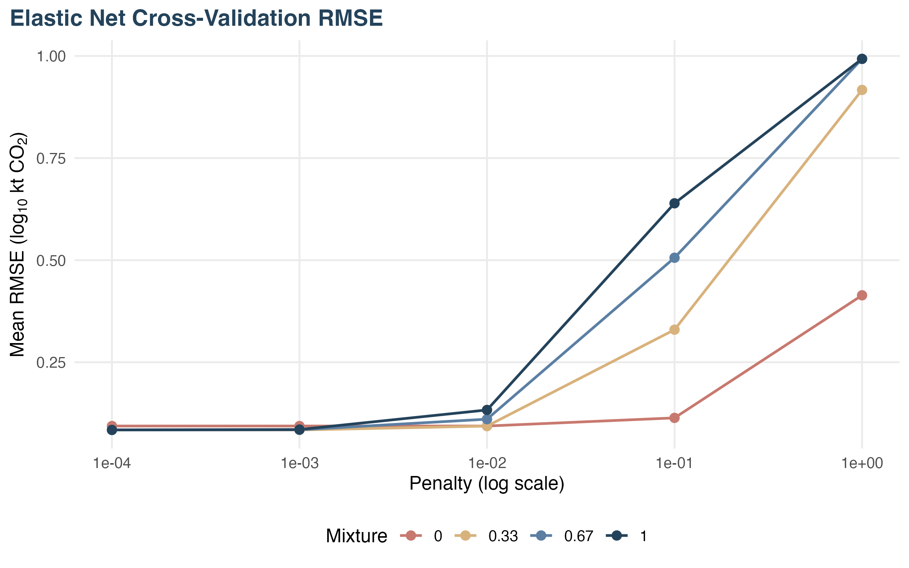
```

## K-Nearest Neighbors

KNN predicts from nearby standardized observations. I tune six values of $K$. The lowest mean RMSE is **0.0911** at $K=7$. Its standard error is 0.0054. The RMSE becomes larger when $K$ increases. Large neighborhoods mix observations with different emission levels.

```{r knn-tuning, fig.cap="Figure 8. KNN mean cross-validation RMSE across the six candidate neighborhood sizes."}
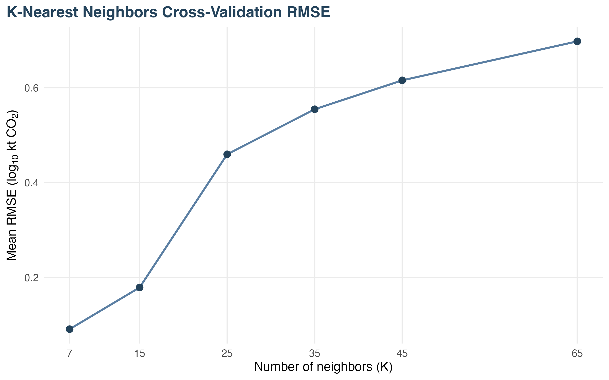
```

## Random Forest

Random forest can learn nonlinear patterns and interactions. It does not need predictor scaling. I use 500 trees and `min_n = 10`. The best value is `mtry = 5`. Its mean RMSE is **0.0792**. Its standard error is 0.0113. This is the lowest mean RMSE among the five models. Its result changes more across folds than the other top models.

```{r random-forest-tuning, fig.cap="Figure 9. Random forest mean cross-validation RMSE across six mtry values."}
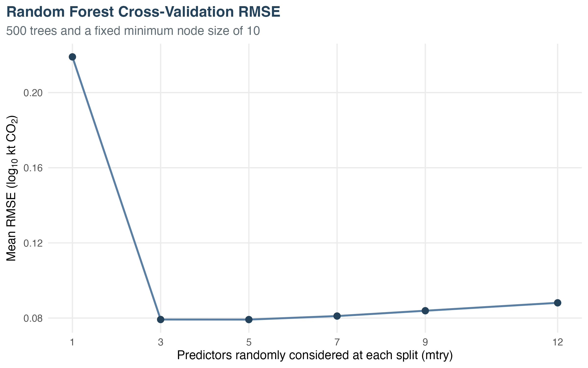
```

## Gradient-Boosted Trees

Gradient boosting builds trees one after another. Each new tree tries to reduce earlier errors. I use 1,000 trees and `min_n = 10`. The best learning rate is 0.10. The best tree depth is 2. This setting has a mean RMSE of **0.0898**. Its standard error is 0.0061. The other settings have higher RMSE values.

```{r boosted-tuning, fig.cap="Figure 10. Gradient-boosted-tree mean cross-validation RMSE across learning rates and tree depths."}
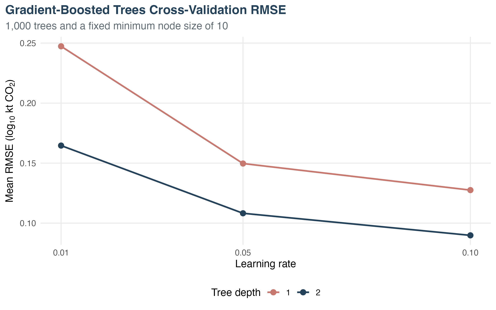
```

# Best Model Selection

## Cross-Validation Performance

Table 4 ranks the models with training-set cross-validation only. I use mean RMSE for this ranking. Random forest is first. Linear regression is second, and elastic net is third. KNN has the largest error. All five mean RMSE values are below 0.10 on the log10 scale.

```{r cv-comparison-table}
cv_comparison |>
  transmute(
    Rank = rank,
    Model = model,
    `Mean RMSE` = round(mean_rmse, 4),
    `Standard error` = round(std_err, 4),
    `Selected hyperparameters` = selected_parameters
  ) |>
  kable(caption = "Cross-validation performance and selected hyperparameters")
```

## RMSE Comparison Plot

Figure 11 compares all five mean RMSE values. Random forest has the lowest point. Its error bar overlaps with linear regression and elastic net. I treat the top results as close.

```{r rmse-comparison-figure, fig.cap="Figure 11. Mean ten-fold cross-validation RMSE with one-standard-error bars."}
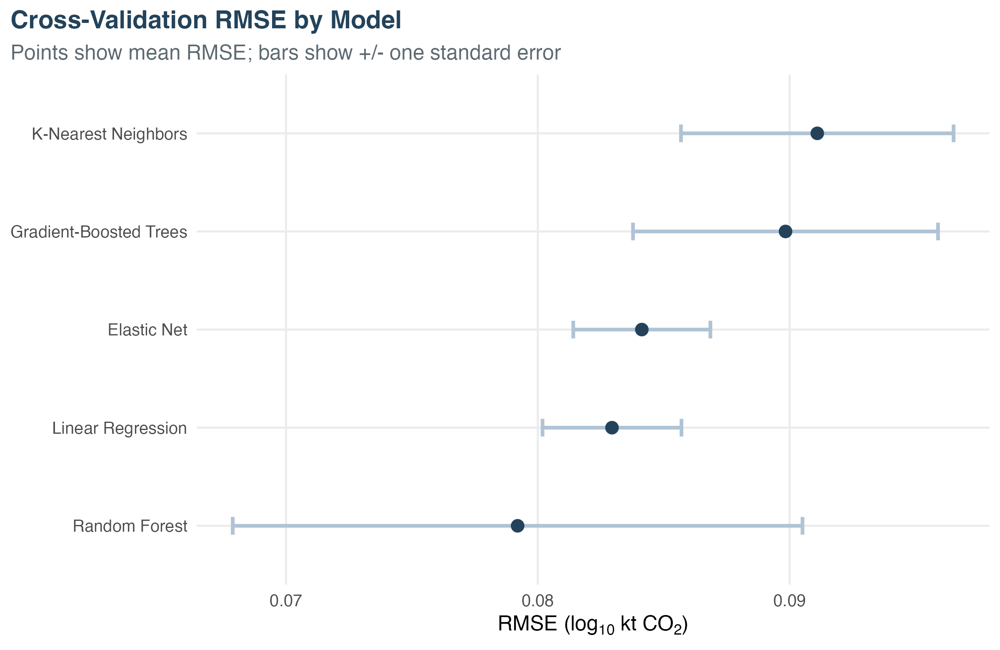
```

## Best Selected Model

Random forest has the lowest mean cross-validation RMSE. I select it as the best model. Only random forest is used on the final test set. The other four models are not tested.

# Final Test Performance

## Finalize the Selected Model

The final random forest uses `mtry = 5`, 500 trees, and `min_n = 10`. I fit this workflow on all 1,676 training observations. It predicts the 424 test observations from 2016–2019. The test outcomes are not used during preprocessing, tuning, or model selection.

## Test RMSE

Random forest has a test log10 RMSE of **0.1113**. This gives a multiplicative error factor of about 1.29. A factor of 1.29 means an error of about 29% in multiplicative terms. Individual errors can be larger or smaller. The test RMSE is higher than the cross-validation RMSE. Prediction for later years is more difficult.

```{r final-test-table}
test_metrics |>
  transmute(
    Model = model,
    `CV RMSE (log10)` = round(cv_rmse_log10, 4),
    `Test RMSE (log10)` = round(test_rmse_log10, 4),
    `Generalization gap` = round(generalization_gap, 4),
    `Multiplicative factor` = round(multiplicative_error_factor, 2),
    `Test RMSE (original kt)` = scales::comma(round(test_rmse_original_kt))
  ) |>
  kable(caption = "Random forest performance on the untouched test years")
```

The original-scale RMSE is strongly affected by a few very large emitters. I selected the log-scale metric before fitting the models because it gives more balance across countries.

## Predicted Versus Observed Values

Figure 12 plots the random forest predictions against observed values. Most points are close to the diagonal line. The correlation is above 0.99 on the log scale. Some of the largest errors are underpredictions in recent years. The log axes also keep low- and medium-emission countries visible.

```{r prediction-figure, fig.cap="Figure 12. Random forest predictions versus observed test-set emissions."}
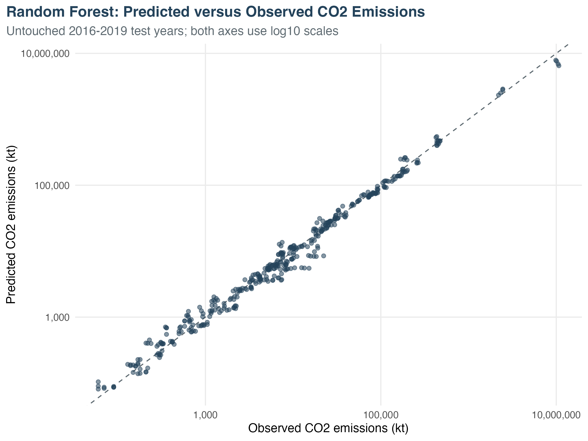
```

## Model Interpretation

Figure 13 shows permutation importance for the final random forest. Fossil electricity is the most important predictor. Land area is second. Renewable electricity and nuclear electricity follow. Renewable electricity also represents the size of a country's electricity system. Its importance does not mean that renewable energy increases CO2 emissions. Correlated predictors can share importance. I read this plot as predictive importance only.

```{r importance-figure, fig.cap="Figure 13. Ten largest random forest permutation-importance values."}
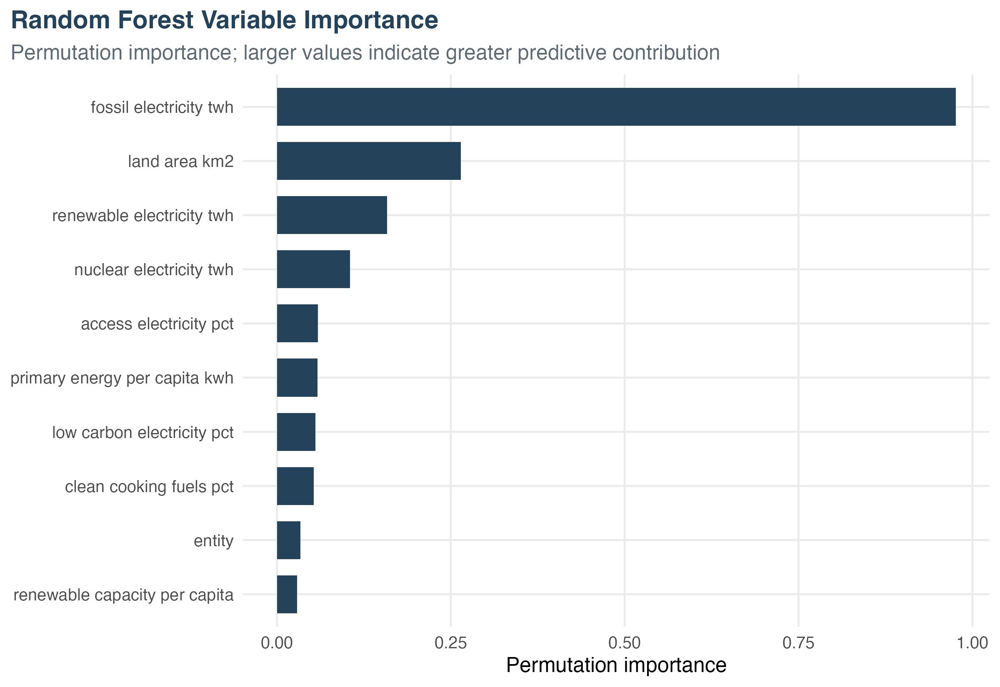
```

# Conclusion

## Main Findings

The selected indicators predict country-level CO2 emissions well on the log scale. Random forest has the lowest cross-validation RMSE at 0.0792. I select it as the best model and test it on 2016–2019. Its test log10 RMSE is 0.1113. This is a multiplicative error factor of about 1.29.

Fossil electricity is the strongest predictor in the random forest. Land area, renewable electricity, and nuclear electricity also have high importance. These variables describe energy use and country size. I cannot use this result to prove which action will reduce emissions. It can help me choose questions for future research.

## Limitations

Missing data are the largest limitation. The prepared data keep 2,100 of the 3,649 raw observations. Countries with more complete data may be overrepresented. This may reduce model performance for countries with less complete data. All 2020 outcome values are missing. I cannot test the models on that year.

The data also have repeated observations from the same countries. Different years from one country can appear in both parts of a cross-validation fold. This may make the cross-validation RMSE too low. The later-year test set helps check this problem. Its higher RMSE shows a time gap in model performance. The country predictor also limits prediction for a new country. I cannot treat correlation or variable importance as causation. Future work could use country-grouped cross-validation, missing-data imputation, and newer data.

# References

Tanwar, A. (n.d.). *Global Data on Sustainable Energy (2000–2020)* [Data set]. Kaggle. [https://www.kaggle.com/datasets/anshtanwar/global-data-on-sustainable-energy/data](https://www.kaggle.com/datasets/anshtanwar/global-data-on-sustainable-energy/data)
